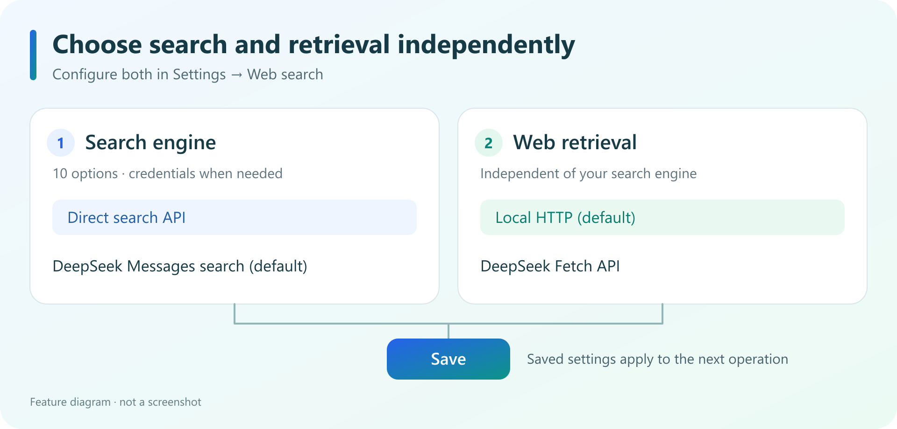

# Web search

Give your DeepSeek Harness agent more ways to search the web through the familiar `web_search` tool. Choose search and retrieval independently, then save both in one settings page.

## Choose how to search

- **Call a search API directly**: DeepSeek Search API, Tavily, Brave Search, Serper, SerpApi, Exa, SearXNG, Scavio, or Firecrawl.
- **Keep the default**: DeepSeek Messages search, using an account token or API key.
- **Try without a key**: choose Tavily `keyless`, or a SearXNG instance with JSON output enabled. Public services may apply rate limits.

## Get started in three steps

1. Enable the plugin and open **Settings → Web search**.
2. Choose a search engine and supply credentials when needed. Under **Web retrieval**, independently choose local HTTP (the default) or DeepSeek Fetch API.
3. Click **Save**. The next search or retrieval uses the saved settings.

The default search engine is **DeepSeek Messages search**. Switch engines and save to call a search API directly. New API options are available only when the Host provides the required configuration.

## Costs and credentials

Direct search API calls do not make an additional DeepSeek search model request, but the search service may charge separately. Your conversation and the model reading search results still consume tokens. DeepSeek Messages search makes a model request and may incur model charges. Check the provider's terms for DeepSeek Fetch API charges.

Engines that require a key provide an API key link in settings. Enter your key and save; the plugin uses DSH credential management. Keyless access still has service limits.

## Guides and feedback

- [Full guide](https://github.com/X-C1811/dsh-web-search-plugin/blob/main/README.md)
- [Report an issue](https://github.com/X-C1811/dsh-web-search-plugin/issues)
