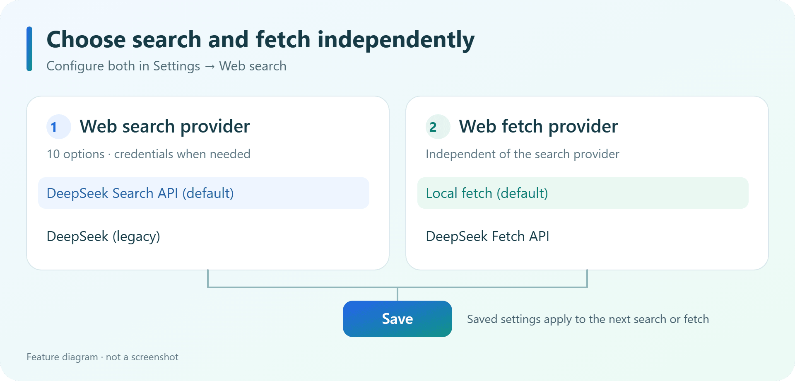

# Web search & fetch

Give your DeepSeek Harness agent more ways to search the web through the familiar `web_search` tool. Choose the web search provider and the web fetch method independently, then save both in one settings page.

## Choose how to search

- **Call a search API directly**: DeepSeek Search API, Tavily, Brave Search, Serper, SerpApi, Exa, SearXNG, Scavio, or Firecrawl.
- **Keep the official default**: DeepSeek Search API, ready after install with no auxiliary model call per search.
- **Use legacy search instead**: DeepSeek (legacy), where models on the account route use the signed-in account and every other request uses the API key.
- **Try without a key**: choose Tavily `keyless`, or a SearXNG instance with JSON output enabled. Public services may apply rate limits.

## Get started in three steps

1. Enable the plugin and open **Settings → Web search**.
2. Choose a web search provider and supply credentials when needed. Under **Web fetch provider**, independently choose local fetch (the default) or DeepSeek Fetch API.
3. Click **Save**. The next search or retrieval uses the saved settings.

The default search provider is **DeepSeek Search API**, matching DSH's own page. Billing for both new and legacy DeepSeek can be Automatic, Account, or API key. New API options are available only when the Host provides the required configuration.

## Costs and credentials

Direct search API calls do not make an additional DeepSeek search model request, but the search service charges separately, paid by the account or API key chosen under Billing. Your conversation and the model reading search results still consume tokens. DeepSeek (legacy) makes a model request and may incur model charges. Local fetch is free and reaches the intranet and this machine, but runs no JavaScript and cannot read PDFs. Check the provider's terms for DeepSeek Fetch API charges.

Engines that require a key provide an API key link in settings. Enter your key and save; the plugin uses DSH credential management. Keyless access still has service limits.

## Guides and feedback

- [Full guide](https://github.com/X-C1811/dsh-web-search-plugin/blob/main/README.md)
- [Report an issue](https://github.com/X-C1811/dsh-web-search-plugin/issues)
