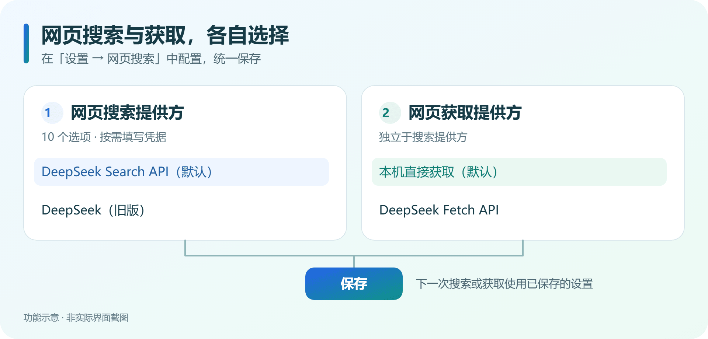

# 网页搜索与获取

为 DeepSeek Harness 的 Agent 提供更多联网搜索选择，沿用熟悉的 `web_search` 工具。网页搜索提供方与网页获取方式独立选择，在一个设置页面中统一保存。

## 选择适合你的搜索方式

- **直接调用搜索 API**：DeepSeek Search API、Tavily、Brave Search、Serper、SerpApi、Exa、SearXNG、Scavio、Firecrawl。
- **保持官方默认（推荐）**：跟随会话模型。DeepSeek 模型用服务端搜索，其他模型用 DeepSeek Search API，安装后即用。
- **固定为服务端搜索**：所有模型都使用 DeepSeek 服务端搜索，账号模型发起的请求用已登录账号，其他请求用 API key。
- **先体验免密钥搜索**：Tavily 选择 `keyless`，或使用支持 JSON 输出的 SearXNG 实例。公共服务可能限流。

## 三步开始

1. 启用本插件，打开 **设置 → 网页搜索**。
2. 选择网页搜索提供方，按需填写凭据；在 **网页获取提供方** 中独立选择本机直接获取（默认）或 DeepSeek Fetch API。
3. 点击 **保存**，下一次搜索或抓取使用已保存的设置。

默认**跟随会话模型**，与 DSH `0.2.2-rc.5` 自带页面一致：DeepSeek 模型用服务端搜索（不按次收费，消耗模型 token），其他模型用 DeepSeek Search API（按次计费）。也可在卡片中固定任一引擎。新版 API 与服务端搜索的「计费方式」都可选自动、账号或 API Key；需要新版 API 的选项只在 Host 提供相应配置时可用。

## 费用与凭据

直接调用搜索 API 不会额外发起 DeepSeek 搜索模型请求，但搜索服务可能单独计费，由「计费方式」选定的账号或 API Key 支付；对话及模型读取结果仍消耗 token。DeepSeek 服务端搜索会发起模型请求：搜索不按次收费，但可能产生相应的模型调用费用。本机直接获取免费，可访问内网和本机，但不支持需要 JavaScript 或登录的页面和 PDF；DeepSeek Fetch API 的费用以供应商说明为准。

需要密钥的引擎可通过设置页的入口获取 API key，填写后保存。插件沿用 DSH 凭据管理；免密钥模式不代表服务无限额。

## 使用说明与反馈

- [完整中文说明](https://github.com/X-C1811/dsh-web-search-plugin/blob/main/README.zh.md)
- [报告问题](https://github.com/X-C1811/dsh-web-search-plugin/issues)
