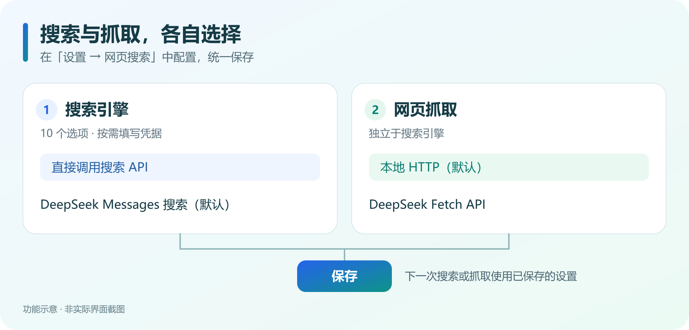

# 网页搜索

为 DeepSeek Harness 的 Agent 提供更多联网搜索选择，沿用熟悉的 `web_search` 工具。搜索引擎与网页抓取独立选择，在一个设置页面中统一保存。

## 选择适合你的搜索方式

- **直接调用搜索 API**：DeepSeek Search API、Tavily、Brave Search、Serper、SerpApi、Exa、SearXNG、Scavio、Firecrawl。
- **保留默认搜索方式**：DeepSeek Messages 搜索，支持账号令牌或 API key。
- **先体验免密钥搜索**：Tavily 选择 `keyless`，或使用支持 JSON 输出的 SearXNG 实例。公共服务可能限流。

## 三步开始

1. 启用本插件，打开 **设置 → 网页搜索**。
2. 选择搜索引擎，按需填写凭据；在 **网页抓取** 中独立选择本地 HTTP（默认）或 DeepSeek Fetch API。
3. 点击 **保存**，下一次搜索或抓取使用已保存的设置。

默认搜索引擎为 **DeepSeek Messages 搜索**。若要直接调用搜索 API，请主动切换引擎并保存；需要新版 API 的选项只在 Host 提供相应配置时可用。

## 费用与凭据

直接调用搜索 API 不会额外发起 DeepSeek 搜索模型请求，但搜索服务可能单独计费；对话及模型读取结果仍消耗 token。DeepSeek Messages 搜索会发起模型请求，可能产生相应费用。DeepSeek Fetch API 的服务费用以供应商说明为准。

需要密钥的引擎可通过设置页的入口获取 API key，填写后保存。插件沿用 DSH 凭据管理；免密钥模式不代表服务无限额。

## 使用说明与反馈

- [完整中文说明](https://github.com/X-C1811/dsh-web-search-plugin/blob/main/README.zh.md)
- [报告问题](https://github.com/X-C1811/dsh-web-search-plugin/issues)
